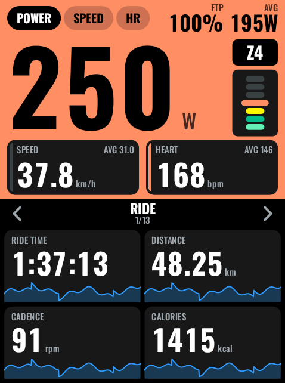
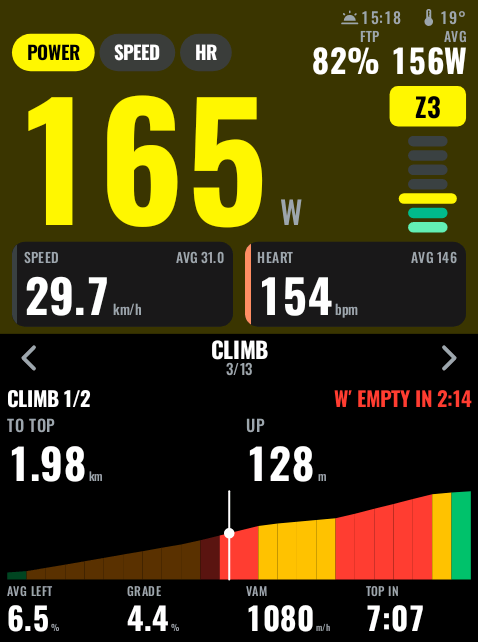
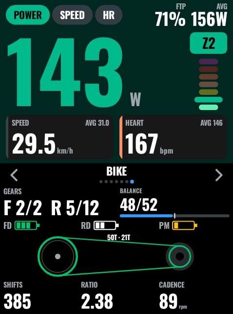
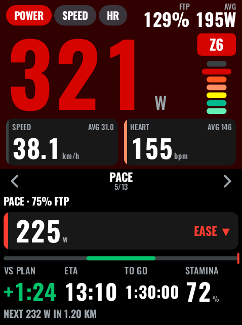
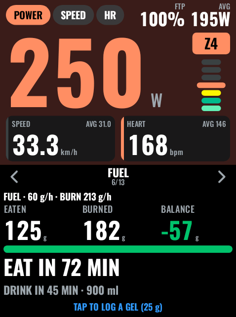
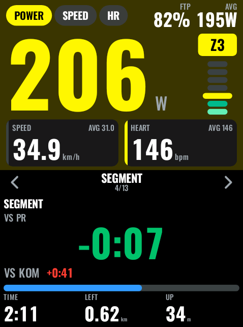
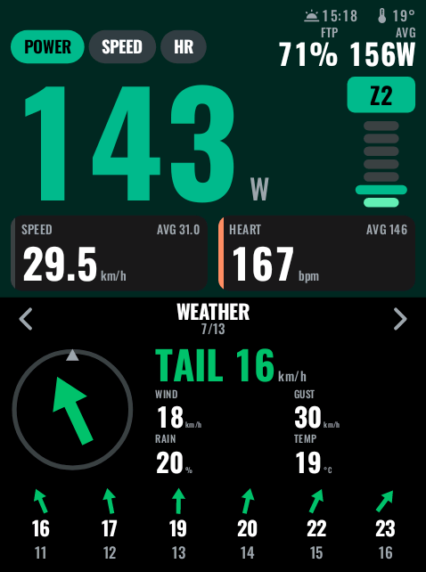
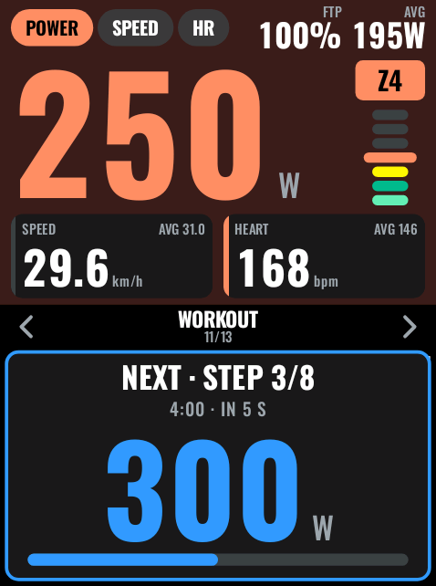

# Pangu Dash: ride by effort on your Karoo

Pangu Dash is a free, open-source extension for the **Hammerhead Karoo 3** (and Karoo 2) that puts your whole ride on one page. Formerly KarooPro; part of [Pangu Lab](https://lab.pangucycling.cc).

<p>
  
  
  
</p>

The top of the page shows one big number: 3-second power, speed or heart rate, and optionally 10-second power, % FTP or W/kg. Tap it to switch between the ones you picked. Two cards sit right below: by default the two of power, speed and heart rate that aren't on top, or any two values you choose. The number and the page are colored by your training zone, so you feel your effort before you read it. A slim line above it shows sunset and the temperature, which the Karoo's own top bar doesn't.

Below that is a panel you flip with a tap on its left or right side.

| Panel | What it shows |
|---|---|
| **Ride** | Four tiles you choose, each with an icon, a colored side bar and a small graphic that fits the value: ride time in hours (or the way to your arrival while navigating), distance along the route, calories per 10 minutes, cadence against your target band, or a 5-minute mini graph |
| **Effort** | 10-minute effort bars colored by zone, W′ balance, grade, VAM, ascent, terrain profile (the route ahead while navigating) |
| **Climb** | While you navigate a route with climbs: opens by itself 200 m before each climb and goes back at the top. Climb number, distance and height to the top, average grade left, grade, VAM, time to the top, how long your W′ lasts at this power, and the climb's profile colored by grade. Before a climb it shows how far away it is, its length, gain, average and steepest grade |
| **Segment** | Opens by itself when a Strava Live Segment comes up: the gap to your PR in big type (green ahead, red behind), the gap to the KOM, progress, time, distance and climbing left, then your result for 10 seconds |
| **Pace** | While you navigate a route: a Power Guide-style target power for the stretch you're on (more on climbs, less on descents), PUSH / EASE, time ahead of or behind the plan, arrival time, time to go, stamina, and the next change of target |
| **Fuel** | Carbs eaten versus burned (estimated from your power), whether you keep up with your target, and when to eat and drink next. A tap in the middle logs a gel (or a bar or bottle, as you choose). Beeps when it's time to eat or drink |
| **Weather** | Head, tail or crosswind for your direction of travel, gusts, rain chance, temperature, and the next 6 hours (Open-Meteo) |
| **Lap** | Four lap fields; averages show the change against the previous lap, such as +20 W |
| **Analysis** | Best 5 s / 1 min / 5 min / 20 min power, time in zones, NP, TSS, IF, climbing, work |
| **Results** | Appears after your first finished climb or segment: each one with its time, average power, W/kg and VAM, or the gaps to your PR and KOM, newest first |
| **Workout** | Opens by itself during a structured workout: step, time left, target with PUSH / EASE and the gap (such as +6 W), or IN RANGE (the color shades from green to blue or red as you drift off), step average, time in target, and the next step's target when Pangu Coach knows your plan |
| **Bike** | Opens by itself when Di2 or AXS connects: gears, drivetrain with chain line OK or a cross-chain warning, batteries, L/R balance, shifts, ratio. Beeps when you shift onto the smallest cog (two high blips) or the largest (two low ones) |
| **Coach** | Appears when the [Pangu Coach](#karoocoach) extension is installed and set up: your coach's latest message in big type, how old it is, and whether check-ins work. Opens by itself on a new message; tap it to confirm |

With no power meter, Pangu Dash starts on speed and colors by heart rate.

**Workout alerts:**
- 10 seconds before a step ends you get a double beep and a countdown.
- 5-4-3-2-1 ticks are optional.
- When the next step starts, its target is shown for 5 seconds.
- Alerts can appear as a window over the panel or across the full field, plus a Karoo pop-up when you're on another page.

**Extra fields you can place anywhere:**
- **Dash Panels:** the panels without the big top, for the map page or any short, full-width slot. The big number is the first slide, colored by zone. Each panel shrinks to a row of its key values, and Coach messages keep their own look. Tap left or right to flip, and the middle of the big number to switch it. It keeps its own slide, apart from the full Pangu Dash field. Workout and Coach still open by themselves there; Bike doesn't.
- **Dash Strip:** a slim row for map and data pages with up to 6 values you choose (by default W′ balance, stamina, headwind and carb balance). The segment gap, workout target and distance to the top take the first places while they matter.
- **Wind:** a compass that turns with your heading.
- **W′ Balance:** in kJ.
- **W′ Empty In:** how long your W′ lasts at your current 3-second power. Empty while you ride at or below CP.
- **Headwind:** head (+) or tail (−) wind in your speed unit.
- **Crosswind:** crosswind from either side in your speed unit.
- **Best 20 min:** your best 20-minute power so far this ride.

**Tiles and cards** can show any of about 50 values. Besides the usual power, speed, heart rate, cadence, distance, time and climbing values, there are:
- Power: 20-minute and 1-hour power, VI, kcal/h.
- Pedaling: pedal smoothness, torque effectiveness.
- Heart rate and body: % HRR, core temperature (CORE sensor).
- Bike: tyre pressure front and rear.
- Time: time to sunset.
- Navigation: distance to go, arrival time, climbing left.
- W′ empty in, crosswind.
- Stamina (long term and now), effort left at your current power.
- Carbs burned, eaten and the balance.
- Pace target and time ahead of or behind the plan.

**Your FIT file** gets Pangu Dash's own values as developer fields every second: W′ balance, carbs burned and eaten, stamina and headwind, plus the carb totals for the ride. intervals.icu shows them as extra charts.

<p>
  
  
  
  
  
</p>

## Map layers

While you navigate a route, Pangu Dash draws on top of the Karoo's own map:

- **Wind on the route ahead (next 30 km):** green for tailwind, yellow for crosswind, red for headwind. Each point uses the Open-Meteo forecast for the hour you'll actually get there, based on your average speed.
- **Climbs by grade (next 50 km):** a grey-to-black band under the route, darker for steeper: 3–6 %, 6–9 %, 9–12 %, 12 %+.
- **Wind arrows every 5 km:** they point where the wind blows, in the same colors.

Each layer can be switched off in Pangu Dash's settings. The layers need an active navigation with a GPS fix, and the wind needs WiFi or the Companion app.

## Pangu Coach

Pangu Coach is a separate extension that lets an AI coach (Claude, from your phone) read your live ride and send you short messages. When it's installed and set up, Pangu Dash gets a **Coach** panel:

- A new message opens the Coach panel. Pangu Coach then skips its own pop-up while the Pangu Dash page is on screen.
- Tap anywhere on the panel to confirm an unread message. The coach sees it, and the field goes back to the panel you were on.
- With the Coach panel on, rides whose profile has the Pangu Dash field check in with your coach, just like rides with the Coach field.
- Check-ins also carry what only Pangu Dash computes: W′ balance, your best 5 s, 1, 5 and 20 min power, head- and crosswind, and how you're riding the workout step and rode the last one. So the coach can recap intervals and warn you when W′ runs low.
- During a workout, a Coach panel that opened by itself goes back to your target after 20 seconds, unless you tap it.
- Hide the panel in Settings to turn all of this off. Pangu Coach's own field and pop-ups keep working either way.

## Install

**Karoo 3, with the Companion app:**
1. On your phone, open the [latest release](https://github.com/mschache/pangu-dash/releases/latest).
2. Long-press `app-release.apk` and share the link to the **Hammerhead Companion** app.
3. Confirm the install on the Karoo. The Karoo must be on WiFi.
4. Later versions appear as updates in the Karoo's extension list.

**Karoo 2 or developers, with adb:**
1. Enable Developer options on the Karoo: Settings → About → tap Build number 7 times.
2. Turn on USB debugging.
3. Run:

```bash
adb install -r app-release.apk
```

## Set up the page

1. On the Karoo, open **Profiles** and choose or create a profile.
2. Go to **Data pages**, add a page and remove its default field.
3. Tap **Add field** → **Pangu Dash** → **Pangu Dash**. The field fills the page.

Now ride:
- Tap the top half to switch the big number.
- Tap the left or right third of the lower half to change panels.

For the map page, add **Pangu Dash** → **Dash Panels** below the map instead.

You can also map these to a remote button as Karoo bonus actions:
- **Pangu Dash: next panel**, **previous panel** (they flip whichever Pangu Dash field is on screen), **switch the big number**.
- **Pangu Dash: ate a gel**, **ate a bar**, **drank a bottle**, to log fuel without looking.

## Settings

Open the **Pangu Dash** app on the Karoo to:
- Hide or reorder panels, and choose whether Workout, Bike, Coach, Climb and Segment open by themselves.
- Turn the gear-limit beep on or off.
- Set your carbs (g/h) and drink (ml/h) targets, the reminders, the carbs in a gel, bar and bottle, and what a tap on the Fuel panel logs.
- Set pacing: the target on the flat as % of FTP, your bike's weight and riding position.
- Choose the Dash Strip's values.
- Pick which big numbers the tap switches between and which one it starts on, the two cards under it, the zone color style (tint the page, fill the top, or color the number) and the theme.
- Choose the 4 Ride tiles and the 4 Lap fields.
- Set CP and W′ for W′ balance (CP defaults to your Karoo FTP; W′ to 20 kJ).
- Set the workout alert style, beeps and the pop-up on other pages.
- Turn weather on or off.

**Preview** shows the real field with demo data, so you can check every panel without riding. Switch between **Dash** and **Dash Panels** at the top to see either field. Once Pangu Coach is set up, the Coach panel there shows its real latest message.

## Good to know

- **Next workout step.** The Karoo shares only the running workout step. The countdown to the next step is exact, but its target normally appears when the step starts. With [Pangu Coach](#karoocoach) set up, and a workout from your intervals.icu plan or pushed through the coach, the Workout panel and the 10-second alert show the next step's duration and power target ahead of time (for example "NEXT 4:00 @ 280 W").
- **Weather.** Weather comes from [Open-Meteo](https://open-meteo.com). It needs WiFi or the Companion app, and is fetched only while the Weather panel, a wind tile or card, or a wind field is in use: every 15 minutes, or after 3 km.
- **Live Segments.** The Segment panel needs Strava Live Segments on the Karoo (a Strava subscription, with starred segments synced). The Karoo may also show its own segment screen; swipe back to the Pangu Dash page to see the panel.
- **Stamina, pacing and fuel are estimates.**
  - **Stamina:** comes from your FTP, CP and W′. Above CP your W′ decides how long an effort lasts; below it, a long-duration power curve does.
  - **Pacing:** assumes still air and a speed model from your weight, bike and position.
  - **Carbs burned:** come from your power at about 24 % efficiency, with more carbohydrate the harder you ride. Without a power meter they come from the Karoo's calorie estimate and your heart rate.
- **Battery levels.** Di2/AXS and power-meter batteries are shown as the levels the Karoo reports (new, good, OK, low, critical), not percentages.
- **Rendering.** The field is drawn as a single image about once per second, the Karoo's limit for extension views. When its page is not on screen, it stops drawing.

## Build

You need JDK 17+ and the Android SDK. karoo-ext comes from JitPack, so no GitHub token is needed.

```bash
./gradlew testDebugUnitTest assembleDebug
```

Releases are built by GitHub Actions from a `vX.Y.Z` tag. That tag must match `karoopro.version` in `gradle.properties`.

The release keystore is passed in through these repository secrets:
- `KEYSTORE_BASE64`
- `KEYSTORE_PASSWORD`
- `KEY_ALIAS`
- `KEY_PASSWORD`

The workflow attaches `app-release.apk` and `manifest.json`, which the Karoo uses to find updates.

## Credits and license

- **License:** Pangu Dash is licensed under Apache-2.0.
- **SDK:** Built on Hammerhead's [karoo-ext](https://github.com/hammerheadnav/karoo-ext) (Apache-2.0).
- **Weather:** Data by [Open-Meteo.com](https://open-meteo.com) (CC BY 4.0).
- **Fonts:** On the field, numbers (Bold) and labels (Medium) use [Oswald](https://github.com/googlefonts/OswaldFont). The app's screens use Pangu's type: [Archivo](https://github.com/Omnibus-Type/Archivo) Expanded Black Italic, [IBM Plex Mono](https://github.com/IBM/plex) Medium and [Inter Tight](https://github.com/rsms/inter-tight). All under the SIL Open Font License 1.1, see `LICENSES/`.
- **Other open-source Karoo extensions (Apache-2.0 / MIT):**
  - The Karoo zone colors and the bitmap-number approach come from [BigNum](https://github.com/smartycoder/karoo-bignum).
  - The update throttle follows [ki2](https://github.com/valterc/ki2).
  - The wind math follows [Headwind](https://github.com/timklge/karoo-headwind).
  - Workout stream handling follows [Workout+](https://github.com/angkyria/karoo-workout-plus).

Pangu Dash is not affiliated with Hammerhead or SRAM.
